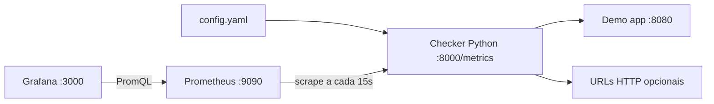
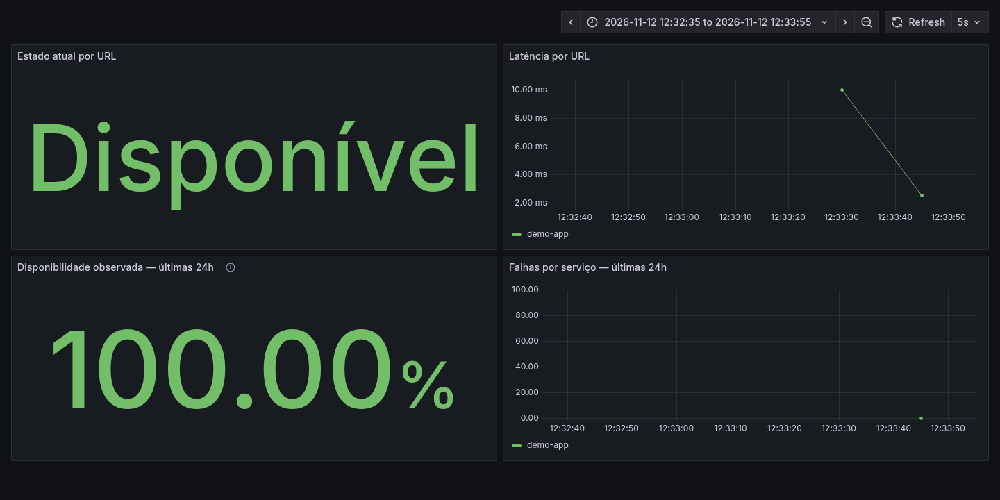
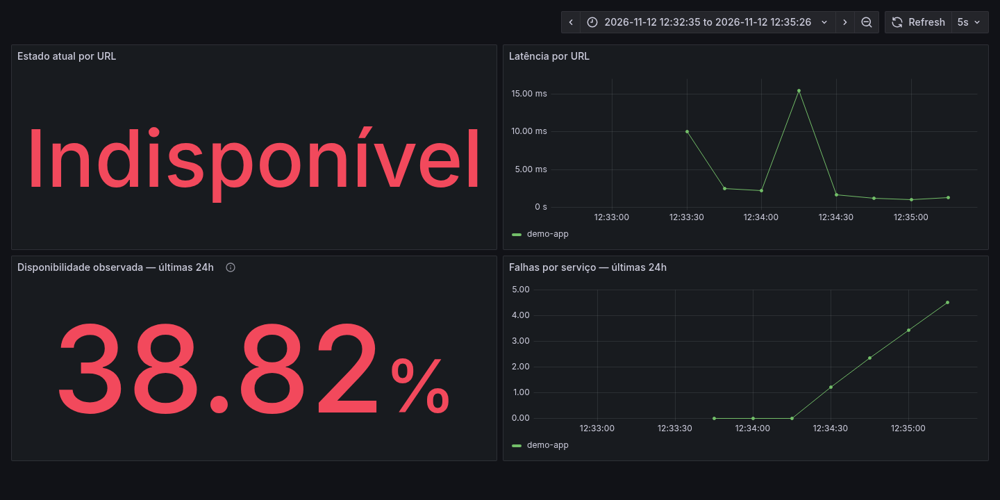
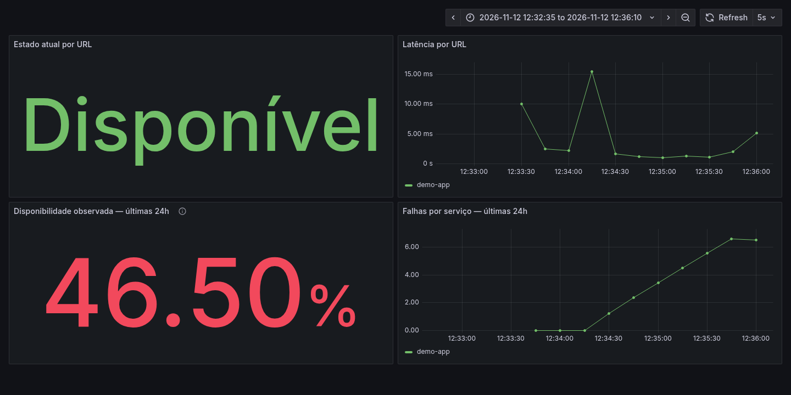

# Healthcheck com Prometheus e Grafana

Projeto de portfólio DevOps/SRE: um checker Python consulta URLs em paralelo,
expõe métricas e permite acompanhar falhas e recuperação em um dashboard pronto.
Cada alvo tem um loop independente. O checker usa GET HTTP, não ping ICMP.



## Executar

Requer Docker com Compose v2 (Docker Desktop ou Colima). As imagens suportam
Apple Silicon e Linux amd64, sem `platform` fixada. Não é necessário instalar
Prometheus ou Grafana na máquina. Python 3.12 é necessário apenas para testes locais.

Antes de iniciar, confirme que as portas 3000, 8000, 8080 e 9090 estão livres.
No macOS, por exemplo: `lsof -nP -iTCP -sTCP:LISTEN`. Se estiverem ocupadas,
resolva o conflito antes de continuar; não pare processos desconhecidos.

Dentro da pasta deste projeto:

```bash
docker compose up --build -d --wait
docker compose ps
curl http://localhost:8000/metrics
```

| Serviço | Endereço |
| --- | --- |
| Checker | http://localhost:8000/metrics |
| Demo app | http://localhost:8080 |
| Prometheus targets | http://localhost:9090/targets |
| Alertas | http://localhost:9090/alerts |
| Dashboard | http://localhost:3000/d/healthcheck-overview |

Grafana: usuário **admin**, senha **admin**, exclusivamente para este laboratório
local. As portas são publicadas em `127.0.0.1`. Se o Grafana solicitar troca de senha,
você pode usar a opção de pular para continuar o laboratório. Datasource e dashboard
são provisionados automaticamente. Após pelo menos dois scrapes, os cálculos
de disponibilidade e falhas começam a aparecer.

## Configuração

Edite `config.yaml` e reinicie somente o checker com `docker compose restart checker`.
`interval_seconds` e `timeout_seconds` devem ser positivos e finitos. Os nomes
dos alvos devem ser únicos. URLs precisam ser HTTP(S), sem credenciais.
Sucesso significa que o status recebido é exatamente o `expected_status`.
Redirects não são seguidos. O timeout limita toda a checagem; respostas são
lidas em streaming para evitar baixar corpos grandes. Logs usam apenas o nome
do alvo, status e classe do erro, sem imprimir a URL.

O alvo padrão é apenas `http://demo-app:8080`, acessível na rede do Compose.
Exemplos externos opcionais: `https://example.com` e `https://httpbin.org/status/200`.
O checker não usa proxies/credenciais do ambiente; destinos externos precisam
de acesso direto à internet. O servidor de métricas é dedicado ao laboratório.
Os gauges surgem após a primeira checagem, evitando indicar falha antes dela.

## Métricas

| Métrica | Tipo | Labels | Significado |
| --- | --- | --- | --- |
| `healthcheck_up` | Gauge | target | 1 para sucesso, 0 para falha |
| `healthcheck_duration_seconds` | Gauge | target | Duração da última checagem em segundos |
| `healthcheck_http_status_code` | Gauge | target | Último status HTTP; 0 sem resposta |
| `healthcheck_checks_total` | Counter | target, result | Checagens acumuladas: success ou failure |

Disponibilidade observada nas últimas 24 horas:

```promql
100 * sum by (target) (increase(healthcheck_checks_total{result="success"}[24h]))
  / sum by (target) (increase(healthcheck_checks_total[24h]))
```

É a proporção de checagens bem-sucedidas, não o tempo ligado do processo nem
a duração exata de uma indisponibilidade. `increase` considera resets dos contadores.
Sem checagens suficientes, o painel mostra ausência de dados. Em uma instalação
nova, a janela contém apenas o histórico já coletado, não 24 horas completas.

## Simular falha e recuperação

```bash
docker compose stop demo-app
```

Em até aproximadamente 20 segundos (intervalo + timeout),
`healthcheck_up{target="demo-app"}` muda para 0. Veja também status 0 e logs
com `docker compose logs --tail=30 checker`. No Prometheus, o alerta `TargetDown`
passa de pending a firing após 1 minuto contínuo de falha mais os atrasos de
scrape/avaliação: aguarde aproximadamente 60–100 segundos após a detecção.
Essa regra aparece no Prometheus; não há Alertmanager nem notificações externas.

```bash
docker compose start demo-app
```

A próxima checagem bem-sucedida restaura o valor 1. O alerta se resolve na
próxima avaliação após o scrape de recuperação. O contador de falhas continua
preservando o histórico.

## Testes locais sem internet

A instalação de dependências requer internet; os testes usam apenas mocks.

```bash
python3 -m venv .venv
source .venv/bin/activate
python -m pip install -r requirements-dev.txt
python -m pytest -q
```

Os testes cobrem YAML inválido, valores e URLs inválidas, nomes duplicados,
status esperado, falhas HTTP, conexão, timeout, recuperação e parada do loop.
SIGTERM/SIGINT interrompem novas checagens e aguardam a atual até seu timeout.

## Encerrar

```bash
docker compose down
docker compose ps -a
```

Não deve haver containers listados. Os volumes nomeados de Prometheus e Grafana
são preservados. Execute comandos Compose sempre dentro desta pasta. A rede
e os recursos pertencem ao projeto `healthcheck-prometheus`. Não há montagem
do socket Docker ou de diretórios externos ao projeto, nem containers privilegiados.

## Prints do dashboard

Capturas reais de uma execução local com dados do checker e do Prometheus.
O método de execução está descrito em [VALIDACAO.md](VALIDACAO.md).

**Estado normal:** demo-app disponível, com latência e disponibilidade sendo coletadas.



**Falha:** demo-app parado e identificado como indisponível; as falhas aparecem no histórico.



**Recuperação:** demo-app disponível novamente; o histórico das falhas permanece visível.


